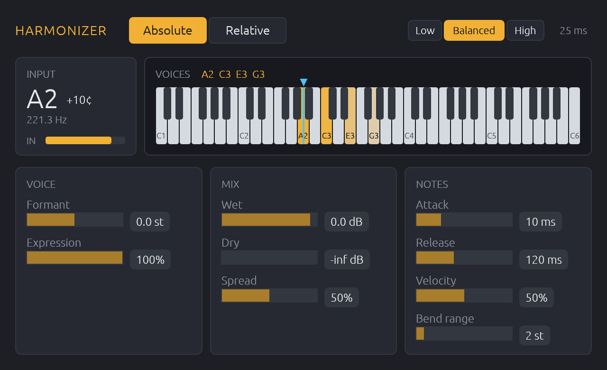

# Harmonizer

**Play a chord. Turn one voice into a choir.**

Harmonizer re-pitches live audio to the MIDI notes you play. Use it as a VST3
in Ableton Live or render WAV files with the command-line tool.



**[Hear the demo — dry, then harmonized (MP3)](docs/media/harmonizer-demo.mp3?raw=true)**

The same synthetic vocal phrase twice: first dry, then re-pitched into a
four-chord progression in Absolute mode.

- **Absolute** follows the pitch of a single voice or instrument and maps it to
  the notes you hold, with control over how much vibrato and pitch movement carry through.
- **Relative** shifts the whole input by an interval for each note you hold.
  Use it on pads, chords, or loops.

Both modes preserve formants by default so you can change pitch without
losing the character of the source.

## Get started

With [Rust 1.100 or newer](https://rustup.rs/) installed, build the VST3 from
the repo root:

```sh
cargo xtask bundle harmonizer-plugin --release
```

- [Ableton Live guide](docs/ableton-live.md) — install on macOS, route audio and MIDI, and troubleshoot silence.
- [Command-line guide](docs/cli.md) — render a chord or follow a MIDI file.
- [Development guide](docs/development.md) — build, test, and validate the plugin.

## Licence

Copyright © 2026 Douglas Anderson. Harmonizer is licensed under the
[GNU General Public License, version 3 only](LICENSE).
Vendored `nice-plug` retains its [ISC licence](vendor/nice-plug/LICENSE).
