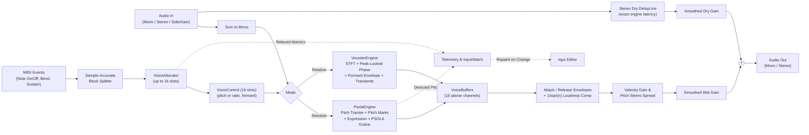
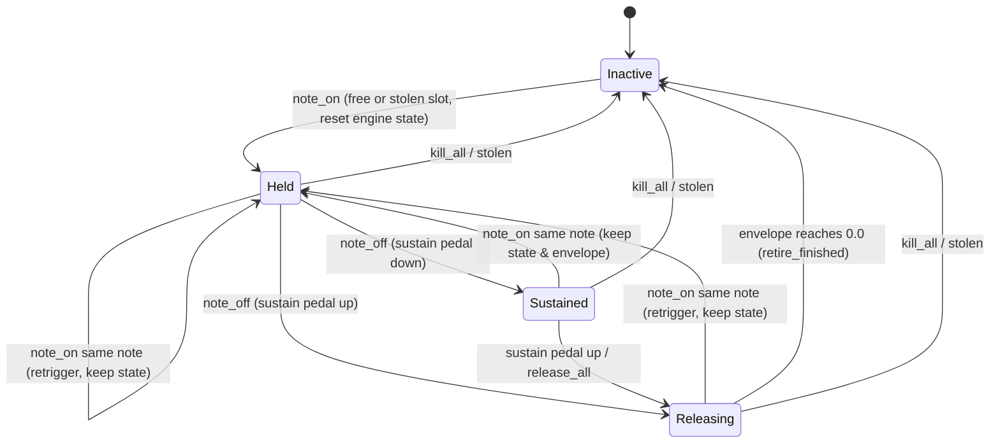
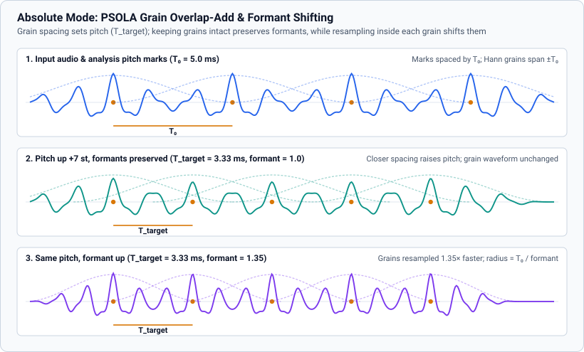
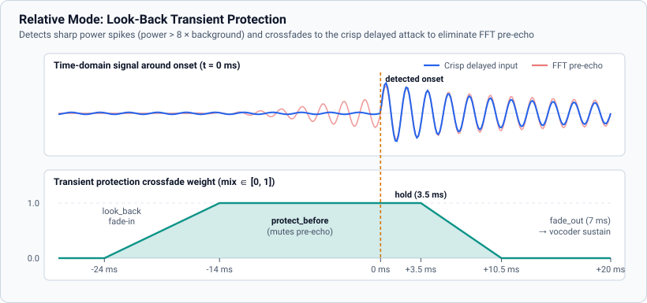

# How Harmonizer Works

Harmonizer is a realtime, MIDI-driven polyphonic harmonizer written in Rust. Feed it audio and hold MIDI notes (or play a MIDI clip), and it renders up to 16 harmony voices — one per active note — while preserving vocal formants and keeping the dry signal latency-aligned.

It ships as a VST3 plugin bundle (containing both an audio-effect variant and a sidechain-fed instrument variant) and as an offline command-line renderer.

## Repository Layout

| Crate / Path | Role |
| --- | --- |
| `crates/harmonizer-dsp` | Pure Rust DSP library with no plugin-framework dependencies. Houses the `Harmonizer` facade, `VoiceAllocator`, `PsolaEngine`, `PitchTracker`, and `VocoderEngine`. |
| `crates/harmonizer-plugin` | VST3 wrapper built on `nice-plug` (with an `egui` editor). Exports both **Harmonizer** (`Fx`) and **Harmonizer Instrument** (`Instrument`). |
| `crates/harmonizer-cli` | Offline renderer (`harmonizer` binary) that drives `Harmonizer` block-by-block from WAV + MIDI/note-list inputs. |
| `crates/vst3-smoke` | Minimal headless VST3 host that loads the built bundle and checks buses, parameters, latency reporting, MIDI-driven audio, state, and editor support. |
| `xtask` | Build helper (`cargo xtask bundle harmonizer-plugin --release`) that produces `target/bundled/Harmonizer.vst3`. |

---

## 1. Architecture & Signal Flow

All audio processing flows through [`Harmonizer`](../crates/harmonizer-dsp/src/harmonizer.rs). Both the VST3 plugin and the offline CLI split incoming audio blocks at exact MIDI event sample offsets, delivering `note_on`, `note_off`, pitch bend, and sustain pedal events between `Harmonizer::process` calls.

### Key Signal-Path Details

- **Mono analysis, stereo dry & spread:** Incoming stereo audio is averaged to mono (`1 / channel_count`) before entering the active re-pitching engine. The dry signal bypasses the mono sum and passes through a stereo `DelayLine` matched to `engine.latency()`, preserving the original stereo image and phase-aligning it with the wet harmony voices.
- **Two VST3 plugin classes:** Because DAWs differ in how they route MIDI to audio effects, [`harmonizer-plugin`](../crates/harmonizer-plugin/src/lib.rs) exports two classes sharing the same DSP and UI:
  - **Harmonizer (`Fx`):** Sits directly on an audio track (mono or stereo) and receives MIDI routed from a MIDI track.
  - **Harmonizer Instrument (`Instrument`):** Sits directly on a MIDI track with no main audio input and copies its input from a stereo **Sidechain** auxiliary bus before running the exact same processing loop.
- **Continuous background analysis:** Both engines implement the [`Engine`](../crates/harmonizer-dsp/src/engine.rs) trait and continue analysing incoming audio even when zero voices are active. When a note arrives, the pitch tracker or STFT overlap buffer already has valid history.

---

## 2. Voice Allocation, Envelopes & Polyphonic Mixing

[`VoiceAllocator`](../crates/harmonizer-dsp/src/voices.rs) manages `MAX_VOICES = 16` fixed voice slots and runs per-voice linear attack/release envelopes.

- **Smooth retriggering:** Pressing a note that is already active (held, sustained, or releasing) reuses its slot without resetting the engine's synthesis state (`needs_reset = false`), avoiding clicks or phase discontinuities.
- **Three-tier voice stealing:** When all 16 slots are active, `VoiceAllocator::steal` prefers:
  1. The quietest **releasing** voice (lowest envelope level).
  2. The oldest **sustained** voice.
  3. The oldest **held** voice.
- **Block-size-invariant retirement:** Because both engines scale unshifted passthrough/attack audio by the active voice count, retiring a finished voice at the end of a large callback would produce different output than retiring it mid-buffer in smaller callbacks. `Harmonizer::samples_until_retirement` predicts the exact sample a releasing voice's envelope will reach zero and splits the internal block right there.
- **Chord loudness compensation (`1 / sqrt(n)`):** Uncorrelated voices at different pitches sum in power rather than amplitude. On every sample, `Harmonizer` computes `power = sum(envelope^2)` across active voices and targets `1 / sqrt(max(power, 1.0))`. An asymmetric one-pole smoother ducks quickly (**2 ms** fall) as voices join so chords never swell, and recovers gently (**30 ms** rise) as voices fade out.
- **Velocity & stereo spread:** Each voice is scaled by `1 - sensitivity + sensitivity * velocity` and panned across the stereo field by its pitch relative to C3 (MIDI 60): `pan = spread * clamp((note - 60) / 24, -1, 1)` — lower notes move left, higher notes move right.
- **Pitch bend:** Normalised pitch bend (`-1.0..=1.0`) is scaled by `pitch_bend_range` (default ±2 semitones) and added to every active voice's MIDI note before converting to Hz (Absolute) or pitch ratio (Relative).

---

## 3. Absolute Mode: Pitch Tracking & PSOLA (`PsolaEngine`)

Absolute mode is designed for monophonic pitched sources (vocals, solo strings, brass, synths). Rather than shifting by a fixed interval, it tracks the input's fundamental frequency $f_0$ and resynthesises the audio at each held MIDI note's exact pitch.

### Pitch Tracking (`PitchTracker`)

[`PitchTracker`](../crates/harmonizer-dsp/src/pitch.rs) estimates the input period $T_0$ (in samples, supporting fundamentals up to 1000 Hz) every **3 ms** hop using an FFT-accelerated **Normalized Square Difference Function (NSDF)**:

$$\text{NSDF}(\tau) = \frac{2 \sum_{j} x_j \, x_{j+\tau}}{\sum_{j} \left(x_j^2 + x_{j+\tau}^2\right)}$$

1. **Autocorrelation via FFT:** The mean-centred analysis window is zero-padded and transformed with `realfft`, squared in magnitude, and inverse-transformed to compute the autocorrelation across all lags in $O(N \log N)$ time. Prefix-summed energy normalises each lag into $[-1, 1]$.
2. **First strong peak selection:** Everything before the first zero-crossing is ignored (skipping the trivial lag-0 peak). Among local maxima above the clarity threshold (`0.80` on onset, `0.72` while tracking, or `0.9 * best`), the tracker picks the earliest strong peak — preferring the true fundamental over subharmonic multiples ($2 T_0$, $3 T_0$).
3. **Sub-sample accuracy:** Parabolic interpolation (`peak_offset`) around the winning lag refines $T_0$ to sub-sample precision.
4. **Breathy-vowel fallback:** If broadband aspiration masks the full-band NSDF, a secondary analysis runs on a shorter **18 ms** window low-passed at **1.3 kHz** (2nd-order filter) where low harmonics survive.
5. **Octave-jump hysteresis & onset lookback:** Single-hop octave jumps (`0.46..=0.55` or `1.82..=2.18`) must be confirmed on a second consecutive hop before taking effect. When a voiced segment begins after unvoiced audio, `onset_lookback` retroactively fills up to 5 ms of the latency ring buffer with the detected period so note attacks pitch-lock cleanly.

### Pitch-Mark Detection (`AnalysisMarks`)

To slice the input waveform cleanly into single-cycle grains without phase smearing, [`AnalysisMarks`](../crates/harmonizer-dsp/src/psola.rs) locates one pitch mark per glottal cycle:

- Incoming audio passes through a 3-stage **900 Hz** low-pass filter to isolate the fundamental wave shape.
- While tracking continuously, each new mark is searched within $\pm 18\%$ of `last_mark + period`, taking the local maximum and refining its fractional sample position with parabolic interpolation.

### PSOLA Grain Overlap-Add & Formant Shifting

For each active voice, [`PsolaEngine`](../crates/harmonizer-dsp/src/psola.rs) places synthesis grain centres spaced by the target period $T_{\text{target}} = f_s / f_{\text{target}}$ (clamped to $[0.25\,T_0,\, 4\,T_0]$). For each synthesis centre, it selects the nearest analysis mark and overlap-adds a Hann-windowed grain centred on that mark.

- **Why formants stay natural:** Moving synthesis grains closer together increases the repetition rate (higher pitch), while the waveform *inside* each grain is copied at its original speed — so vocal tract resonances (formants) remain unchanged.
- **Independent formant shifting:** When the **Formant** knob is non-zero (`formant_ratio != 1.0`), each grain is linearly resampled around its source mark at `grain.source + offset * formant_ratio` with a scaled window radius `period / formant_ratio`. This shifts the vocal tract resonances up or down without changing the note's pitch.
- **Unison bypass:** When `formant_ratio == 1.0` and the target pitch is within ~0.12% of the input pitch, the engine marks the grain `neutral` and blends the latency-aligned dry sample directly to avoid unnecessary resampling.
- **Unvoiced passthrough & low-cut:** During unvoiced consonants (`period == 0`), each voice crossfades over **4 ms** to unshifted dry passthrough scaled by $1 / \sqrt{n}$ (because identical consonant copies sum in amplitude while pitched voices sum in power). A per-voice 2nd-order state-variable high-pass filter (`0.4 * target_pitch`, capped at 100 Hz) removes sub-fundamental rumble from shifted grains.

### Expression Contour

Purely snapping every grain to the MIDI note's frequency sounds robotic. [`ExpressionContour`](../crates/harmonizer-dsp/src/psola.rs) extracts the singer's natural vibrato and pitch scoops while removing steady pitch offset:

- Tracks a slow pitch centre ($\tau \approx 180\text{ ms}$) in log-pitch (octave) space.
- Deviation from that centre (clamped to $\pm 100$ cents, weighted by pitch clarity) modulates the target frequency when **Expression** > 0%.
- If deviation exceeds **55 cents** (an intentional glide), the centre switches to a fast **12 ms** tracker for 180 ms so the glide settles onto the new note cleanly. Jumps over **150 cents** reset the contour immediately.
- To compensate for the pitch tracker's half-window lag, `ExpressionContour::ratio` looks ahead in the latency ring buffer and extrapolates using the smoothed contour slope when needed.

### Absolute Mode Quality Presets

| Quality | Latency | Min Tracked Pitch | Analysis Window |
| --- | --- | --- | --- |
| **Low Latency** | 16 ms | 80 Hz | 26 ms |
| **Balanced** (default) | 25 ms | 60 Hz | 36 ms |
| **High Quality** | 45 ms | 50 Hz | 45 ms |

---

## 4. Relative Mode: Phase Vocoder (`VocoderEngine`)

Relative mode works on any audio — chords, pads, full mixes, drums, or vocals — by transposing every active voice by the ratio $2^{(\text{note} - \text{reference\_note}) / 12}$ (default reference note is C3 / MIDI 60).

[`VocoderEngine`](../crates/harmonizer-dsp/src/vocoder.rs) runs a Short-Time Fourier Transform (STFT) overlap-add pipeline with Hann analysis and synthesis windows.

### Peak-Locked Phase Vocoder

A classic phase vocoder shifts every FFT bin independently, which breaks the phase relationship across a Hann window's main lobe and produces a hollow, "phasey" sound. Harmonizer uses **identity phase locking**:

1. **Region segmentation (`find_regions`):** Every FFT frame's magnitude spectrum is scanned for local peaks above a noise floor (`loudest * 1e-4`). Midpoints between adjacent peaks partition the spectrum into `Region { peak, end }` slices, and every bin is assigned to its owning peak.
2. **Peak-locked phase rotation:** For each peak, the engine computes its true instantaneous phase advance from the previous frame and multiplies by `(pitch - 1.0)` to get the phase delta. A single complex rotation is accumulated from the previous frame's owning peak (`previous_owners[peak]`) and applied uniformly across the entire region.
3. **Intact lobe shifting:** All bins in a region are shifted together by the integer bin offset `shift`, with a sign flip (`-cos, -sin`) on odd bin shifts to keep the phase reference centred in the Hann window. Bins that would alias above Nyquist are dropped cleanly.

### Spectral Envelope Formant Preservation

To stop voices from sounding like chipmunks when shifted up (or giants when shifted down), `Analysis::smooth_envelope` estimates the input's smooth spectral envelope every frame:

1. **Valley filling:** Each bin takes the local maximum magnitude within a $\pm 85\text{ Hz}$ radius, bridging the gaps between individual harmonics so inter-partial dips aren't mistaken for formant valleys.
2. **Log-magnitude smoothing:** A sliding boxcar average over the same $\pm 85\text{ Hz}$ radius in the log-magnitude domain yields a smooth spectral envelope `envelope[k]`.
3. **Envelope rescaling:** When shifting bin `src` to `dst`, the engine multiplies by `clamp(envelope[dst / formant_ratio] / envelope[src], 0.125, 8.0)`. With `formant_ratio = 1.0`, shifted partials inherit the original vocal tract shape at their new frequencies; moving the **Formant** knob stretches or compresses the target envelope independently.

### Look-Back Transient Protection

Because an STFT window spans tens of milliseconds, a sharp percussive hit or vocal consonant gets smeared backwards in time as **FFT pre-echo** and loses its punch. [`Transients`](../crates/harmonizer-dsp/src/vocoder.rs) protects attacks directly inside the engine's latency buffer:

1. **Onset detection:** Every hop, incoming samples are scanned in ~1 ms steps against an exponentially decaying background power estimate ($\tau = 12\text{ ms}$). When `power > max(8 * background, 1e-6)` (with a 20 ms recovery lockout), an onset is marked at its exact future output position in the latency ring buffer.
2. **Look-back crossfade window:** `Transients::protect` writes a trapezoidal protection weight into the latency buffer *before* the onset reaches the output:
   - Ramps up from `look_back` (up to 24 ms before onset) to full weight at `protect_before` (up to 14 ms before onset), muting the smeared FFT pre-echo.
   - Holds at `1.0` for **3.5 ms** across the crisp attack transient.
   - Fades back to `0.0` over **7 ms**, handing seamlessly off to the pitch-shifted phase vocoder sustain.
3. **Chord-balanced attack gain:** Unshifted attack copies add in amplitude across voices while sustained shifted voices add in power. `VocoderEngine::attack_gain` scales the transient copy so the attack matches the $\sqrt{n}$ loudness of the sustained chord.

### Relative Mode Quality Presets

FFT size scales to the nearest power of two proportional to `sample_rate / 48 kHz`. Exact latency equals one full FFT frame (`size` samples).

| Quality | Base FFT Size (48 kHz) | Overlap | Hop Size | Latency (48 kHz) |
| --- | --- | --- | --- | --- |
| **Low Latency** | 1024 | 4× | 256 samples | 21.3 ms |
| **Balanced** (default) | 2048 | 4× | 512 samples | 42.7 ms |
| **High Quality** | 4096 | 8× | 512 samples | 85.3 ms |

---

## 5. Realtime Safety, Latency & Verification

Audio plugins run inside a strict realtime callback where a single heap allocation, mutex lock, or denormal stall can cause audible glitches. Harmonizer enforces several invariants across the DSP and plugin layers:

- **Zero audio-thread allocations:** `Harmonizer::new` pre-allocates all 6 engine instances (3 quality levels × 2 modes), `VoiceBuffers` for all 16 voices, FFT plans and scratch buffers, grain queues, and the stereo dry `DelayLine` sized to the maximum latency across all engines. Switching modes or quality presets at runtime resets the newly selected engine without allocating.
- **Denormal protection:** Feedback filter states and power estimators (`PitchTracker`, `AnalysisMarks`, `LowCut`, `Transients`) flush magnitudes below `1e-20` to `0.0` so silence never triggers subnormal CPU spikes.
- **Lock-free editor telemetry:** [`Telemetry`](../crates/harmonizer-plugin/src/telemetry.rs) publishes detected pitch, latency, active note envelopes, input meter level, and diagnostic flags (*No audio coming in*, *Waiting for notes*, *No clear pitch*) from the audio thread to the `egui` editor using `Relaxed` atomics, requesting a UI repaint only when a visible value actually changes.
- **Exact latency reporting & offline compensation:** Every `Engine` reports its exact sample latency. The VST3 plugin forwards changes immediately via `context.set_latency_samples`, and `harmonizer-cli` appends a tail (`latency + release + 50 ms`) and drains the leading `latency` samples so offline renders align sample-for-sample with the source WAV.
- **Automated verification:**
  - `crates/harmonizer-dsp/tests/realtime.rs` wraps `Harmonizer::process` and all MIDI/parameter setters in `assert_no_alloc` to fail the test suite on any audio-thread allocation.
  - DSP integration tests verify detected output pitch, latency alignment, and exact block-size invariance (splitting input into arbitrary block sizes yields identical output).
  - `crates/vst3-smoke` loads the compiled `Harmonizer.vst3` bundle into a minimal host and exercises both plugin classes end-to-end.
