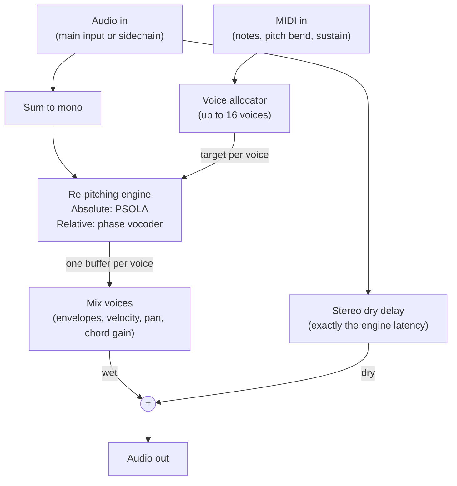
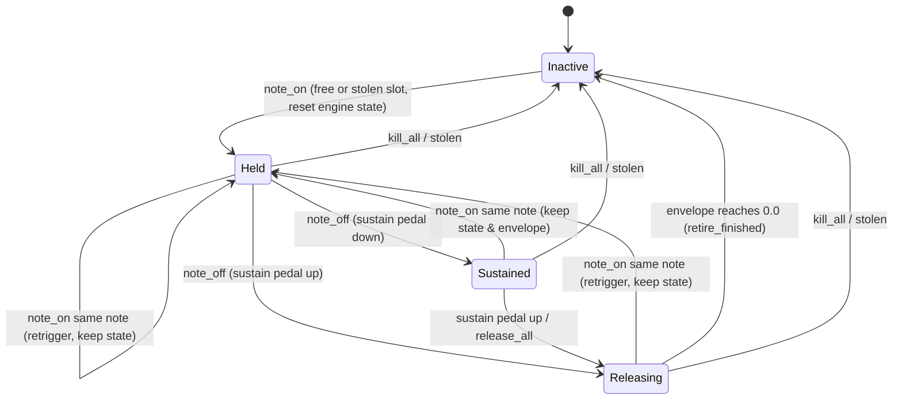
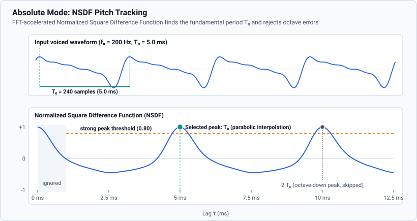
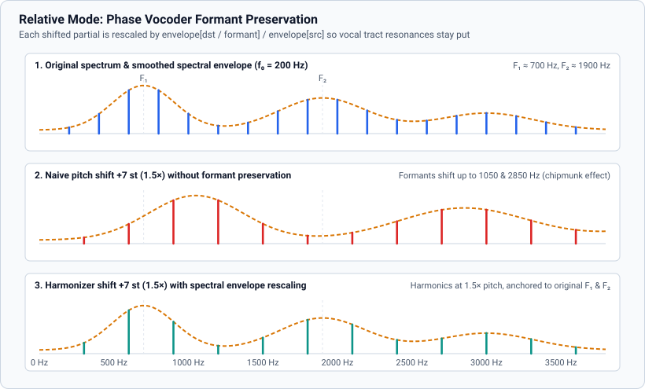

# How Harmonizer Works

Harmonizer re-pitches incoming audio to the MIDI notes you hold. Each held note gets its own voice, up to 16 at once, and the dry signal is delayed so it stays aligned with the harmony.

The two modes differ in what a MIDI note means. Sing a steady 220 Hz (A2) into the plugin and hold MIDI note 60 (C3). Note names follow Ableton Live, where MIDI 60 is C3.

| Mode | What note 60 means | Output |
| --- | --- | --- |
| **Absolute** | "Sing at C3" — the input's pitch is tracked and replaced | about 262 Hz, whatever pitch you sang |
| **Relative** | "Shift by the distance from the reference note" (default C3) | 220 Hz, because 60 − 60 = 0 semitones |

Hold note 64 instead and Absolute sings E3 (about 330 Hz), while Relative shifts the input up four semitones to about 277 Hz. Absolute suits a single voice or instrument with a clear pitch; Relative works on anything, including chords, pads and drums.

Harmonizer ships as a VST3 bundle (an audio effect and a sidechain-fed instrument) and as an offline command-line renderer. Both drive the same DSP code. A [source map](#source-map) at the end lists where each part lives.

---

## 1. Architecture & Signal Flow

All audio processing flows through [`Harmonizer`](../crates/harmonizer-dsp/src/harmonizer.rs). Both the VST3 plugin and the offline CLI split each incoming audio block at the exact sample offsets of its MIDI events, delivering note on/off, pitch bend and sustain pedal events between `Harmonizer::process` calls.



- **Mono analysis, stereo dry:** Stereo input is averaged to mono before it reaches the re-pitching engine. The dry signal skips that sum and passes through a stereo `DelayLine` set to exactly `engine.latency()`, so it keeps its stereo image and lines up with the wet voices.
- **One target per voice:** Before each block, `Harmonizer` turns every allocated voice's note (plus pitch bend) into a target: a frequency in Hz for Absolute mode, or a pitch ratio for Relative mode.
- **Two VST3 plugin classes:** DAWs differ in how they route MIDI to audio effects, so [`harmonizer-plugin`](../crates/harmonizer-plugin/src/lib.rs) exports two classes that share the same DSP and UI:
  - **Harmonizer (`Fx`)** sits on an audio track (mono or stereo) and receives MIDI routed from a MIDI track.
  - **Harmonizer Instrument (`Instrument`)** sits on a MIDI track with no main audio input and takes its audio from a stereo **Sidechain** bus.
- **Continuous background analysis:** Both engines implement the [`Engine`](../crates/harmonizer-dsp/src/engine.rs) trait and keep analysing the input even when no voices are active, so the pitch tracker or STFT buffer already has history when a note arrives.
- **Editor telemetry (outside the audio path):** The audio thread publishes the detected pitch, latency, note envelopes and input level to the `egui` editor through lock-free [`Telemetry`](../crates/harmonizer-plugin/src/telemetry.rs). See [section 5](#5-realtime-safety-latency--verification).

---

## 2. Voice Allocation, Envelopes & Polyphonic Mixing

[`VoiceAllocator`](../crates/harmonizer-dsp/src/voices.rs) manages `MAX_VOICES = 16` fixed voice slots and runs per-voice linear attack/release envelopes.



- **Smooth retriggering:** Pressing a note that is already active (held, sustained, or releasing) reuses its slot without resetting the engine's synthesis state (`needs_reset = false`), avoiding clicks or phase discontinuities.
- **Three-tier voice stealing:** When all 16 slots are active, `VoiceAllocator::steal` prefers:
  1. The quietest **releasing** voice (lowest envelope level).
  2. The oldest **sustained** voice.
  3. The oldest **held** voice.
- **Block-size-invariant retirement:** Because both engines scale unshifted passthrough/attack audio by the active voice count, retiring a finished voice at the end of a large callback would produce different output than retiring it mid-buffer in smaller callbacks. `Harmonizer::samples_until_retirement` predicts the exact sample a releasing voice's envelope will reach zero and splits the internal block right there.
- **Chord loudness compensation (`1 / sqrt(n)`):** Uncorrelated voices at different pitches sum in power rather than amplitude. On every sample, `Harmonizer` computes `power = sum(envelope^2)` across active voices and targets `1 / sqrt(max(power, 1.0))`. An asymmetric one-pole smoother ducks quickly (**2 ms** fall) as voices join so chords never swell, and recovers gently (**30 ms** rise) as voices fade out.
- **Velocity & stereo spread:** Each voice is scaled by `1 - sensitivity + sensitivity * velocity` and panned across the stereo field by its pitch relative to C3 (MIDI 60): `pan = spread * clamp((note - 60) / 24, -1, 1)` — lower notes move left, higher notes move right.
- **Pitch bend:** Normalised pitch bend (`-1.0..=1.0`) is scaled by `pitch_bend_range` (default ±2 semitones) and added to every active voice's MIDI note before converting to Hz (Absolute) or pitch ratio (Relative).

---

## 3. Absolute Mode: Pitch Tracking & PSOLA (`PsolaEngine`)

**The idea:** a sung note is a waveform that repeats once per vocal-fold cycle. Find those cycles, cut each one out as a short grain, and lay the grains back down closer together (higher note) or further apart (lower note). The pitch changes, but each grain still holds the original waveform, so the voice keeps its character.

That is **PSOLA** (pitch-synchronous overlap-add): *pitch-synchronous* because grains are cut one per pitch cycle, and *overlap-add* because neighbouring grains are faded in and out with a window and summed. It needs a monophonic source with a clear pitch (vocals, solo strings, brass, synths), and it involves three steps: measure the input's period, mark each cycle, then place grains at the target note's spacing.

### Pitch Tracking (`PitchTracker`)

[`PitchTracker`](../crates/harmonizer-dsp/src/pitch.rs) estimates the input period $`T_0`$ (in samples, for fundamentals up to 1000 Hz) every **3 ms** using the **Normalized Square Difference Function (NSDF)**. The NSDF compares the signal with a copy of itself delayed by lag $`\tau`$: it reaches 1 where the delayed copy lines up perfectly, which happens at the period and at every multiple of it.

```math
\text{NSDF}(\tau) = \frac{2 \sum_{j} x_j \, x_{j+\tau}}{\sum_{j} \left(x_j^2 + x_{j+\tau}^2\right)}
```



*The NSDF peaks at both $`T_0`$ (5 ms) and $`2T_0`$ (10 ms). Both clear the 0.90 cutoff, so the tracker takes the earlier one; taking the later one would report the pitch an octave too low.*

1. **Autocorrelation via FFT:** The mean-centred analysis window is zero-padded and run through a forward and inverse FFT (`realfft`) to get the autocorrelation at every lag in $`O(N \log N)`$ time. Prefix-summed energy normalises each lag into $`[-1, 1]`$.
2. **First strong peak:** Everything before the first zero crossing is ignored, which skips the trivial peak at lag 0. A peak counts as strong only if it clears **both** a fixed floor (`0.80` when no pitch is being tracked yet, `0.72` while tracking) **and** 90% of the best peak in the window. The earliest strong peak wins, which favours the fundamental over its multiples ($`2T_0`$, $`3T_0`$).
3. **Continuity with the previous period:** While already tracking, the tracker also looks for the best peak within 0.8–1.25× of the previous period, and normally prefers that one, so a single noisy frame doesn't make the pitch jump. The earliest strong peak still wins when its lag is clearly shorter (a higher pitch), or when it lies an octave below the nearby peak and is much clearer (see `PitchTracker::analyse`).
4. **Sub-sample accuracy:** Parabolic interpolation (`peak_offset`) around the winning lag refines $`T_0`$ to sub-sample precision.
5. **Breathy vowels:** When aspiration noise masks the full-band NSDF, a second analysis runs on a shorter, low-passed window where the low harmonics survive.
6. **Octave-jump hysteresis & onset lookback:** A jump of about an octave must be confirmed on a second consecutive analysis before it takes effect. When a voiced segment starts after unvoiced audio, `onset_lookback` fills one period of the latency buffer (at most 5 ms) with the new pitch so note attacks lock on cleanly.

### Pitch-Mark Detection (`AnalysisMarks`)

To cut one grain per cycle, [`AnalysisMarks`](../crates/harmonizer-dsp/src/psola.rs) places one pitch mark per glottal cycle. It low-passes the input to isolate the fundamental's shape, then searches for each new mark near `last_mark + period`, taking the local maximum and refining its position to a fraction of a sample.

### PSOLA Grain Overlap-Add & Formant Shifting

For each active voice, [`PsolaEngine`](../crates/harmonizer-dsp/src/psola.rs) places synthesis grain centres spaced by the target period $`T_{\text{target}} = f_s / f_{\text{target}}`$ (clamped to $`[0.25\,T_0,\, 4\,T_0]`$, i.e. two octaves either way). For each synthesis centre, it takes the nearest analysis mark and overlap-adds a Hann-windowed grain centred on that mark.


*Compare the spacing first: panels 2 and 3 place grains 3.33 ms apart, so they produce the same pitch. Then compare the waveform inside each grain: panel 2 copies it unchanged, keeping the formants, while panel 3 squeezes it, moving the formants up.*

- **Why formants stay natural:** Moving grains closer together raises the repetition rate (pitch), while the waveform *inside* each grain plays at its original speed, so the vocal tract resonances (formants) stay where they were.
- **Independent formant shifting:** When the **Formant** knob is non-zero (`formant_ratio != 1.0`), each grain is resampled around its source mark at `grain.source + offset * formant_ratio`, with its window radius scaled to `period / formant_ratio`. This moves the formants up or down without changing the note.
- **Unison bypass:** When `formant_ratio == 1.0` and the target pitch is within about 0.12% of the input pitch, the engine uses the latency-aligned dry sample directly instead of resampling.
- **Unvoiced passthrough & low-cut:** During unvoiced consonants (`period == 0`), each voice crossfades over **4 ms** to unshifted dry audio scaled by $`1 / \sqrt{n}`$, because identical consonant copies sum in amplitude while pitched voices sum in power. A per-voice high-pass filter, set well below the target note, removes rumble from the shifted grains.

### Expression Contour

Snapping every grain exactly to the MIDI note's frequency sounds robotic. [`ExpressionContour`](../crates/harmonizer-dsp/src/psola.rs) keeps the singer's vibrato and pitch scoops while removing their steady pitch offset from the note:

- It tracks a slow pitch centre (about 180 ms) and measures how far the input deviates from it, up to ±100 cents.
- When **Expression** is above 0%, that deviation, weighted by how clear the pitch is, modulates the voice's target frequency.
- Intentional glides (over 55 cents) switch the centre to a fast tracker so the glide settles onto the new note cleanly; large jumps (over 150 cents) reset it immediately.
- To make up for the pitch tracker's lag, `ExpressionContour::ratio` looks ahead in the latency buffer.

### Absolute Mode Quality Presets

| Quality | Latency | Min Tracked Pitch | Analysis Window |
| --- | --- | --- | --- |
| **Low Latency** | 16 ms | 80 Hz | 26 ms |
| **Balanced** (default) | 25 ms | 60 Hz | 36 ms |
| **High Quality** | 45 ms | 50 Hz | 45 ms |

---

## 4. Relative Mode: Phase Vocoder (`VocoderEngine`)

**The idea:** break the input into its frequency components, move every component up or down by the same ratio, and rebuild the audio. Nothing has to be tracked, so it works on any audio — chords, pads, full mixes, drums, or vocals. The hard parts are keeping the rebuilt sound clean, keeping the formants in place, and keeping sharp attacks sharp.

Each voice requests the shift ratio

```math
\text{ratio} = 2^{(\text{note} - \text{reference}) / 12}
```

with C3 (MIDI 60) as the default reference. The engine clamps the ratio to `0.25..=4.0`, i.e. ±24 semitones, so with the default reference MIDI 96 requests 8× but gets 4×.

[`VocoderEngine`](../crates/harmonizer-dsp/src/vocoder.rs) runs a Short-Time Fourier Transform (STFT): it takes overlapping Hann-windowed frames, shifts each frame's spectrum, and overlap-adds the results back together.

### Peak-Locked Phase Vocoder

A classic phase vocoder shifts every FFT bin independently, which breaks the phase relationship across a Hann window's main lobe and produces a hollow, "phasey" sound. Harmonizer uses **identity phase locking**: each spectral peak and the bins around it move as one unit.

1. **Region segmentation (`find_regions`):** Every frame's magnitude spectrum is scanned for local peaks above a noise floor. Midpoints between adjacent peaks split the spectrum into `Region { peak, end }` slices, and every bin is assigned to its peak.
2. **Peak-locked phase rotation:** For each peak, the engine measures its true phase advance since the previous frame and multiplies it by `(pitch - 1.0)` to get the extra phase the shifted peak needs. One complex rotation, accumulated from the previous frame's owning peak (`previous_owners[peak]`), is applied to the whole region.
3. **Intact lobe shifting:** All bins in a region move together by the same whole-bin offset, with a sign flip on odd shifts to keep the phase reference centred in the Hann window. Bins that would land above Nyquist are dropped.

### Spectral Envelope Formant Preservation

Shifting every component also shifts the formants, which makes voices sound like chipmunks when shifted up (or giants when shifted down). To prevent that, `Analysis::smooth_envelope` estimates the input's smooth spectral envelope — the overall shape the vocal tract gives the spectrum — every frame:

1. **Valley filling:** Each bin takes the local maximum magnitude within ±85 Hz, bridging the gaps between harmonics so the dips between them aren't mistaken for formant valleys.
2. **Log-magnitude smoothing:** A sliding average over the same radius in the log-magnitude domain yields a smooth envelope `envelope[k]`.
3. **Envelope rescaling:** When moving bin `src` to `dst`, the engine multiplies it by `clamp(envelope[dst / formant_ratio] / envelope[src], 0.125, 8.0)`. With `formant_ratio = 1.0`, shifted partials take on the original envelope at their new frequencies; moving the **Formant** knob stretches or compresses that envelope independently.



*Follow the F₁ and F₂ bumps. A naive +7 semitone shift (panel 2) drags them up to 1050 and 2850 Hz. Harmonizer's shift (panel 3) moves the harmonics by the same amount but leaves the bumps at 700 and 1900 Hz.*

### Look-Back Transient Protection

An STFT frame spans tens of milliseconds, so shifting a sharp drum hit or consonant smears part of it backwards in time as **FFT pre-echo**, and the attack loses its punch. [`Transients`](../crates/harmonizer-dsp/src/vocoder.rs) fixes this inside the engine's latency buffer: it spots the attack before it reaches the output and crossfades to an unshifted copy of the input around it.


*The teal curve is how much of the unshifted input is heard. It reaches full weight well before the marked onset to cover the pre-echo, and hands back to the vocoder by 10.5 ms after it.*

1. **Onset detection:** Incoming samples are checked in chunks of 1 ms rounded up to a power-of-two length (64 samples, about 1.33 ms, at 48 kHz) against a background power estimate that decays with a 12 ms time constant. When a chunk's *average* power exceeds 8× the background, the start of that chunk is marked as the onset, so the mark is accurate to the chunk grid rather than to the exact sample. A 20 ms lockout prevents another mark straight after.
2. **Look-back crossfade:** `Transients::protect` writes a protection weight into the latency buffer before the marked onset reaches the output:
   - It ramps up from `look_back` before the onset to full weight at `protect_before` before the onset, muting the smeared pre-echo. These are 24 ms and 14 ms at the Balanced and High Quality presets, and about 16 ms and 10.7 ms at Low Latency, whose buffer is shorter.
   - It holds full weight through the onset until **3.5 ms** after it.
   - It fades back to zero over the next **7 ms**, handing off to the pitch-shifted sustain.
3. **Chord-balanced attack gain:** Unshifted attack copies add in amplitude across voices while shifted voices add in power. `VocoderEngine::attack_gain` scales the attack copy so it matches the $`\sqrt{n}`$ loudness of the sustained chord.

### Relative Mode Quality Presets

FFT size scales with `sample_rate / 48 kHz`, rounded to the nearest power of two. Latency is exactly one FFT frame (`size` samples).

| Quality | Base FFT Size (48 kHz) | Overlap | Hop Size | Latency (48 kHz) |
| --- | --- | --- | --- | --- |
| **Low Latency** | 1024 | 4× | 256 samples | 21.3 ms |
| **Balanced** (default) | 2048 | 4× | 512 samples | 42.7 ms |
| **High Quality** | 4096 | 8× | 512 samples | 85.3 ms |

---

## 5. Realtime Safety, Latency & Verification

Audio plugins run inside a strict realtime callback where a single heap allocation, mutex lock, or denormal stall can cause audible glitches. Harmonizer enforces several invariants across the DSP and plugin layers:

- **Zero audio-thread allocations:** `Harmonizer::new` pre-allocates all 6 engine instances (3 quality levels × 2 modes), `VoiceBuffers` for all 16 voices, FFT plans and scratch buffers, grain queues, and the stereo dry `DelayLine` sized to the maximum latency across all engines. Switching modes or quality presets at runtime resets the newly selected engine without allocating.
- **Denormal protection:** Feedback filter states and power estimators (`PitchTracker`, `AnalysisMarks`, `LowCut`, `Transients`) flush magnitudes below `1e-20` to `0.0` so silence never triggers subnormal CPU spikes.
- **Lock-free editor telemetry:** [`Telemetry`](../crates/harmonizer-plugin/src/telemetry.rs) publishes detected pitch, latency, active note envelopes, input meter level, and diagnostic flags (*No audio coming in*, *Waiting for notes*, *No clear pitch*) from the audio thread to the `egui` editor using `Relaxed` atomics, requesting a UI repaint only when a visible value actually changes.
- **Exact latency reporting & offline compensation:** Every `Engine` reports its exact sample latency. The VST3 plugin forwards changes immediately via `context.set_latency_samples`, and `harmonizer-cli` appends a tail (`latency + release + 50 ms`) and drains the leading `latency` samples so offline renders align sample-for-sample with the source WAV.
- **Automated verification:**
  - `crates/harmonizer-dsp/tests/realtime.rs` wraps `Harmonizer::process` and all MIDI/parameter setters in `assert_no_alloc` to fail the test suite on any audio-thread allocation.
  - DSP integration tests verify detected output pitch, latency alignment, and exact block-size invariance (splitting input into arbitrary block sizes yields identical output).
  - `crates/vst3-smoke` loads the compiled `Harmonizer.vst3` bundle into a minimal host and exercises both plugin classes end-to-end.

---

## Source Map

| Crate / Path | Role |
| --- | --- |
| [`crates/harmonizer-dsp`](../crates/harmonizer-dsp) | Pure Rust DSP library with no plugin-framework dependencies. Houses the `Harmonizer` facade, `VoiceAllocator`, `PsolaEngine`, `PitchTracker`, and `VocoderEngine`. |
| [`crates/harmonizer-plugin`](../crates/harmonizer-plugin) | VST3 wrapper built on `nice-plug` (with an `egui` editor). Exports both **Harmonizer** (`Fx`) and **Harmonizer Instrument** (`Instrument`). |
| [`crates/harmonizer-cli`](../crates/harmonizer-cli) | Offline renderer (`harmonizer` binary) that drives `Harmonizer` block-by-block from WAV + MIDI/note-list inputs. |
| [`crates/vst3-smoke`](../crates/vst3-smoke) | Minimal headless VST3 host that loads the built bundle and checks buses, parameters, latency reporting, MIDI-driven audio, state, and editor support. |
| [`xtask`](../xtask) | Build helper (`cargo xtask bundle harmonizer-plugin --release`) that produces `target/bundled/Harmonizer.vst3`. |
